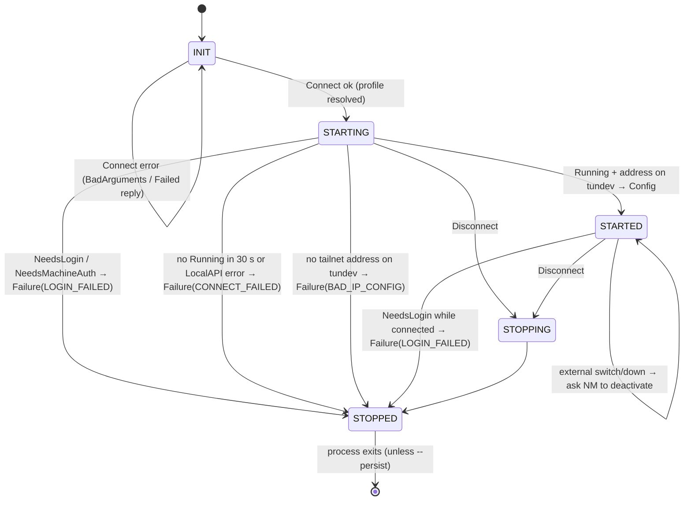

# Architecture

nm-tailscale is a NetworkManager VPN service plugin: a small root process
that NetworkManager starts on the system bus for each active Tailscale
connection. It translates NetworkManager's VPN plugin protocol into a handful
of `tailscaled` LocalAPI calls. It does not configure addresses, routes or
DNS; `tailscaled` keeps doing that.

```
 GNOME / nmcli
      │  (libnm, D-Bus)
      ▼
 NetworkManager ──spawns──▶ nm-tailscale-service ──LocalAPI (HTTP over Unix socket)──▶ tailscaled
      ▲                          │                                                      │
      └── DeactivateConnection ──┘                                                 tailscale0,
          (external changes)                                                       routes, DNS
```

## Components

| Path | Role |
|------|------|
| `cmd/nm-tailscale-service` | Entry point: flags, system bus connection, process lifecycle, NetworkManager presence watch. |
| `internal/nmvpn` | D-Bus adapter. Exports `org.freedesktop.NetworkManager.VPN.Plugin`, parses the connection dictionary, maps errors to NetworkManager error names, emits signals. |
| `internal/service` | Core logic, independent of D-Bus and HTTP: profile resolution, connect/disconnect, IPN bus watch. Talks to the outside through three ports: `Backend` (tailscaled), `Notifier` (signals to NetworkManager) and `Deactivator` (deactivate a connection through NetworkManager). |
| `internal/tailscale` | Minimal LocalAPI client over `/var/run/tailscale/tailscaled.sock`. Implements only the endpoints the plugin needs. |
| `internal/nmclient` | Minimal NetworkManager client: finds the active connection by UUID and calls `DeactivateConnection`. |
| `data/nm-tailscale-service.name` | Plugin descriptor read by NetworkManager. |
| `data/nm-tailscale-service.conf` | System bus policy. |
| `data/selinux/nm-tailscale.te` | SELinux module for Fedora. |

### Process lifecycle

The descriptor declares `supports-multiple-connections=true`, so
NetworkManager starts one process per active connection and passes
`--bus-name org.freedesktop.NetworkManager.tailscale.Connection_N`. The
process:

- exits after its connection reaches `STOPPED`, unless `--persist` is given
  (then a fresh service instance accepts the next `Connect`);
- on `SIGTERM` or `SIGINT`, disconnects and exits;
- when `org.freedesktop.NetworkManager` loses its bus owner (NetworkManager
  stopped or restarted), disconnects and exits, unless `--debug` is given.

Flags:

| Flag | Default | Meaning |
|------|---------|---------|
| `--bus-name` | `org.freedesktop.NetworkManager.tailscale` | Bus name to own; NetworkManager passes the per-connection name. |
| `--persist` | off | Do not exit after the connection stops. |
| `--debug` | off | Verbose logging; do not exit when NetworkManager leaves the bus. |
| `--socket` | `/var/run/tailscale/tailscaled.sock` | Path to the `tailscaled` socket. |

## D-Bus contract

Object path `/org/freedesktop/NetworkManager/VPN/Plugin`, interface
`org.freedesktop.NetworkManager.VPN.Plugin`, both fixed by NetworkManager.

### Methods

| Method | Behaviour |
|--------|-----------|
| `Connect(a{sa{sv}})` | Validates settings and resolves the profile synchronously (bounded to 10 s), replies, then runs the connection flow in the background. |
| `ConnectInteractive(a{sa{sv}}, a{sv})` | Same as `Connect`; the plugin never asks for secrets. |
| `NeedSecrets(a{sa{sv}}) → s` | Always returns an empty string: no secrets needed. |
| `Disconnect()` | Stops the connection (see below). |
| `SetConfig`, `SetIp4Config`, `SetIp6Config`, `SetFailure`, `NewSecrets` | Accepted and ignored; present for interface completeness. |

### Property

| Property | Type | Meaning |
|----------|------|---------|
| `State` | `u` | Current `NMVpnServiceState`: `INIT`=1, `STARTING`=3, `STARTED`=4, `STOPPING`=5, `STOPPED`=6. Emits `PropertiesChanged`. |

### Signals

| Signal | Payload |
|--------|---------|
| `StateChanged(u)` | New `NMVpnServiceState`. |
| `Config(a{sv})` | Generic configuration: `tundev`, `gateway`, `can-persist=true`, `has-ip4=false`, `has-ip6=false`. |
| `Failure(u)` | `NMVpnPluginFailure`: `LOGIN_FAILED`=0, `CONNECT_FAILED`=1, `BAD_IP_CONFIG`=2. |

### Errors

Method errors are returned as `org.freedesktop.NetworkManager.VPN.Error.<Name>`:

| Name | When |
|------|------|
| `BadArguments` | No `vpn` setting, empty `profile`, no or ambiguous profile match, invalid `interface`. |
| `WrongState` | `Connect` while already starting or started. |
| `Failed` | Anything else, for example `tailscaled` unreachable while listing profiles. |

### Connection settings

From the `a{sa{sv}}` dictionary the plugin reads only `connection.uuid` and
the `vpn.data` keys `profile` and `interface`.

## State machine



### Connect

1. Reject with `WrongState` if already starting or started.
2. Validate `interface` (default `tailscale0`; no `/` or whitespace, at most
   15 characters).
3. `GET profiles/` and resolve `profile`: exact ID first, then a unique
   case-insensitive match on name, login name or tailnet domain.
4. Reply to NetworkManager and emit `StateChanged(STARTING)`.
5. In the background:
   - `GET profiles/current`; `POST profiles/<id>` only if a different profile
     is current (the ID comes from step 3 and is URL-escaped);
   - `PATCH prefs {"WantRunningSet":true,"WantRunning":true}`;
   - poll `GET status?peers=false` every 500 ms for up to 30 s until
     `BackendState` is `Running` (`NeedsLogin`/`NeedsMachineAuth` fail
     immediately, transient errors are logged and retried);
   - check that one of the node's `TailscaleIPs` is assigned to the tun
     device, emit `Config`, then `StateChanged(STARTED)`;
   - start the watch.

Every non-streaming LocalAPI request has a 15 s timeout and responses are
capped at 4 MiB.

### Watch

`GET watch-ipn-bus?mask=0` streams IPN notifications. Only notifications
carrying a state, prefs or an error message are considered:

- `NeedsLogin` or `NeedsMachineAuth`: `Failure(LOGIN_FAILED)` and
  `StateChanged(STOPPED)`.
- Otherwise the plugin re-reads `profiles/current` and `prefs`. If the
  current profile is no longer this connection's, or `WantRunning` is false,
  the connection is **released**: it is marked as externally closed and
  NetworkManager is asked to deactivate it.

When the stream ends, it is reopened. After 15 consecutive failures to open
it (2 s apart, about 30 s), the connection is released.

### Disconnect

1. Emit `StateChanged(STOPPING)`; cancel the background flow and wait for it.
2. If the connection was not released and the current profile is still this
   connection's, `PATCH prefs {"WantRunningSet":true,"WantRunning":false}`.
   If another profile is current (the user switched accounts), the tunnel is
   left alone.
3. Emit `StateChanged(STOPPED)`.

## Design decisions

### `has-ip4=false`, `has-ip6=false`, and the gateway

Addresses, routes and DNS for `tailscale0` are owned by `tailscaled`. If the
plugin sent IPv4/IPv6 configuration, NetworkManager would apply it on top of
what `tailscaled` manages. Reporting `has-ip4=false` and `has-ip6=false`
tells NetworkManager that no IP configuration will follow, so it completes
activation as soon as the generic `Config` arrives and leaves the interface
alone.

NetworkManager's generic configuration processing nevertheless requires an
external `gateway`; without it the `Config` signal is rejected. Tailscale has
no single VPN server address, so the plugin reports the node's own tailnet
address, the one it has just confirmed is assigned to the tun device: IPv4
when available, encoded as a native-endian `u32`, otherwise IPv6 as 16 bytes.

### External changes go through `DeactivateConnection`

When `tailscaled` is switched or stopped outside NetworkManager, the plugin
could simply emit `StateChanged(STOPPED)`. NetworkManager, however, always
maps a `STOPPED` state reported by the plugin to a failed activation, and
GNOME would report a failure for something the user did on purpose.

Instead the plugin calls `org.freedesktop.NetworkManager.DeactivateConnection`
on the active connection whose `Uuid` equals `connection.uuid`.
NetworkManager then calls `Disconnect` on the plugin as for a user-initiated
disconnect, and the UI shows a clean deactivation. Because the connection is
marked as released, `Disconnect` does not set `WantRunning=false`, so it
cannot undo the change the user made (for example a switch to another
account).

### Bus policy and confinement

The system bus policy allows only root to own names under
`org.freedesktop.NetworkManager.tailscale` and to send to them; other users
are denied owning those names and sending to the base name. On Fedora the plugin inherits NetworkManager's
`NetworkManager_t` SELinux domain; the shipped module adds exactly the two
permissions needed to reach the `tailscaled` socket.

## Test strategy

All tests run without root and without a real NetworkManager or `tailscaled`.

- **`internal/tailscale`** runs the client against a fake LocalAPI served
  over a temporary Unix socket: request methods, paths and bodies (including
  ID escaping and the `WantRunningSet` mask), response parsing, streaming
  watch, and non-2xx errors.
- **`internal/service`** drives the core through fake `Backend`, `Notifier`
  and `Deactivator` implementations: profile switching or not, unknown,
  ambiguous and empty profiles, login required, timeout, missing interface
  address, external switch and `tailscale down` going through
  NetworkManager, ignored unrelated events, login lost while connected,
  disconnect touching only its own profile, double `Connect`, disconnect
  while starting, and concurrent disconnects.
- **`internal/nmvpn`** exports the real D-Bus object on a private session bus
  and calls it as NetworkManager would: settings parsing, signal emission and
  error name mapping. These tests need a session bus and are skipped
  otherwise; `make test-dbus` runs them under `dbus-run-session`.

Run `go test -race ./...` for concurrency-sensitive changes. End-to-end
behaviour (NetworkManager activation, SELinux, GNOME) is verified manually;
see [installation](installation.md#7-verify).
